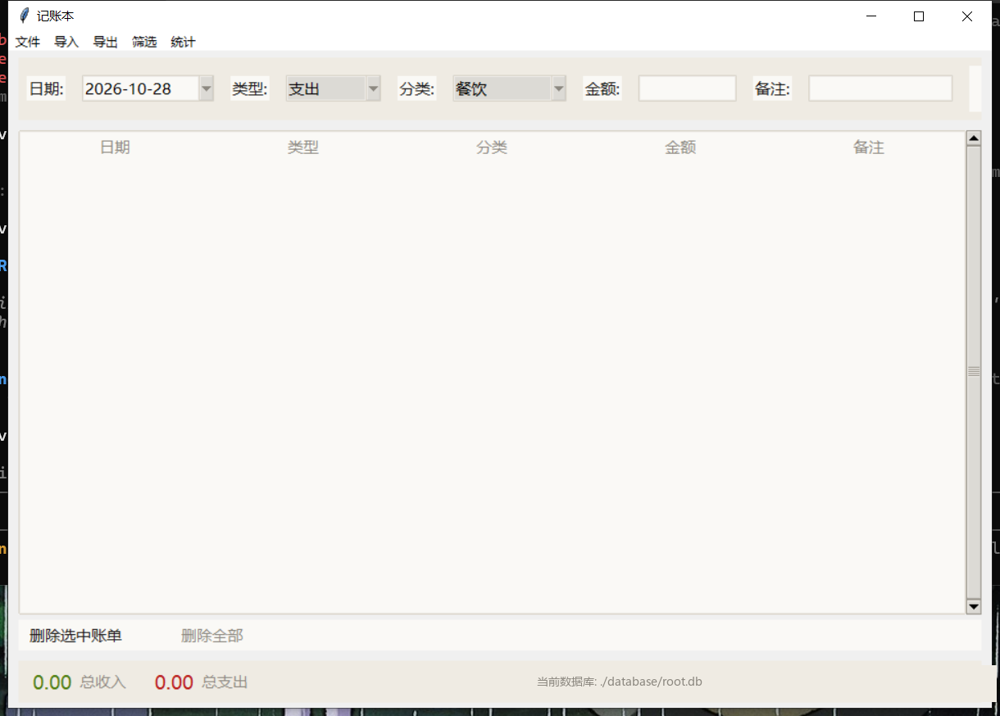

# 记账本 bookkeeping（跨平台桌面版）

[](LICENSE)

一个简洁高效的跨平台桌面记账本程序（Windows / macOS / Linux），支持收入/支出账单管理、支付宝/微信账单导入、可视化统计与数据导出。界面遵循极简主义设计，适合个人日常财务记录与分析。



## 下载即用

前往本仓库的 Releases 页面下载对应平台的构建产物。

### Windows

下载 `bookkeeping.exe`——单文件、免安装、免 Python 环境，双击即用。数据保存在 exe 同目录的 `database/` 文件夹中，可随文件夹整体移动。

> 首次运行如提示"未知发布者"，选择"仍要运行"即可（未购买代码签名证书）。

### Linux

下载 `bookkeeping-linux-x86_64-<版本>.tar.xz`，解压后运行其中的 `bookkeeping` 可执行文件：

```bash
tar -xJf bookkeeping-linux-x86_64-v0.0.3.tar.xz
cd bookkeeping
./bookkeeping
```

数据保存在启动目录的 `database/` 文件夹中，建议固定在一个目录下启动。同目录的 `.sha256` 文件可用于校验下载完整性。

其他平台或需要最新代码可[从源码运行](#从源码运行)。

## 功能简介

### 核心功能
- 添加收入/支出账单（支持分类、金额、日期、备注）
- 账单列表、双击编辑、单条/批量删除
- 账单筛选（按日期、金额、类型、分类）与列头排序
- 底部统计栏实时显示总收入/总支出

### 数据导入
- 标准 CSV 文件导入
- 支付宝账单导入（自动识别列映射，兼容中英文列名）
- 微信账单导入（自动识别列映射，自动去除 ¥ 符号）
- 导入预览与编辑功能

### 数据统计与可视化
- 月度账单统计与收支柱状图
- 单月分类饼图（支持月份切换）
- 双击查看当月明细

### 系统管理
- 多数据库文件管理（新建/打开/切换）
- 数据另存为、一键导出 CSV
- 状态栏显示当前数据库路径
- 应用日志记录（保存于 `logs/` 目录）

### 界面与个性化
- 中/英文界面一键切换（选择持久保存）
- 设置菜单：菜单字号、界面字号自由调节（持久保存）
- 窗口自适应缩放，小窗口下表格支持横向滚动，内容不再被裁剪
- 对话框按内容自适应大小，按钮始终可见

## 项目结构

```text
bookkeeping/
├─ main.py                # 主入口：启动、主题应用、窗口居中
├─ db/
│    └─ database.py       # 数据库操作（SQLite，参数化查询）
├─ model/
│    └─ record_model.py   # 数据模型与统计计算
├─ ui/
│    ├─ theme.py          # 极简主题：配色常量 + ttk/clam 全局样式
│    ├─ main_window.py    # 主窗口类（RecordBook）
│    ├─ dialogs.py        # 弹窗（筛选、编辑、导入映射、预览等）
│    └─ charts.py         # 图表绘制与嵌入
├─ utils/
│    ├─ constants.py      # 常量（分类、路径、字体栈等）
│    ├─ i18n.py           # 界面语言（中/英）翻译与持久化
│    ├─ settings.py       # 应用设置（字号等）读写与持久化
│    └─ logger.py         # 日志配置
├─ examples/              # 匿名化示例账单（体验导入功能用）
├─ test/                  # 单元测试（78 个用例）
├─ requirements.txt       # 依赖清单
├─ LICENSE                # ISC License
└─ docs/                  # 文档
     ├─ 需求规格说明书.md
     ├─ 软件设计说明书.md
     ├─ 界面美化设计.md
     └─ 项目Review报告.md
```

## 从源码运行

### 安装依赖

Windows（PowerShell）：

```bash
python -m venv venv
.\venv\Scripts\pip install -r requirements.txt
```

macOS / Linux：

```bash
python3 -m venv venv
./venv/bin/pip install -r requirements.txt
```

> Linux 需先安装 tkinter 系统包，如 Ubuntu/Debian：`sudo apt install python3-tk`。

### 启动

```bash
# Windows
.\venv\Scripts\python main.py
# macOS / Linux
./venv/bin/python main.py
```

### 执行测试

```bash
pytest        # 78 个测试用例，全部无界面（headless）运行
```

### 打包发布

```bash
pip install pyinstaller
pyinstaller bookkeeping.spec
# 产物：dist/bookkeeping/ 目录（onedir 形式，启动速度快；目录内 bookkeeping 为可执行文件）
# 如需 Windows 单文件版，可改用：pyinstaller --onefile --windowed --name bookkeeping main.py
```

macOS / Linux 平台需在对应系统上执行相同命令，产出对应平台的可执行文件。

## 导入数据格式

### CSV

```csv
日期,类型,分类,金额,备注
2025-01-01,收入,工资,10000,无
2025-01-02,支出,吃饭,100,无
```

### 支付宝账单

CSV 文件，自动跳过前 24 行说明文字，自动映射字段（交易时间→日期、收/支→类型等）。

### 微信账单

Excel 文件（.xlsx），自动跳过前 16 行说明文字，自动去除金额中的 ¥ 符号并识别收支类型。

## 技术特点

- **极简界面**：集中式主题系统（`ui/theme.py`），暖纸色系、斑马纹表格、主次分明的按钮体系，设计稿见 docs/界面美化设计.md
- **安全性**：全部数据库写入使用参数化查询，防止 SQL 注入
- **性能**：executemany 批量插入，自动创建索引
- **跨平台**：Windows / macOS / Linux，中文字体按平台回退
- **可测试性**：78 个单元测试用例，覆盖数据层、导入链路、核心交互
- **国际化**：界面层中/英双语切换，数据层保持中文字段，存量数据与导入流程零影响
- **启动性能**：matplotlib 延迟加载 + onedir 打包，冷启动时间大幅缩短
- **易部署**：PyInstaller 打包，数据与日志锚定可执行文件目录

## 数据存储

数据默认存储在 `./database/root.db`（SQLite 数据库），可通过菜单栏「文件」→「打开/新建」切换数据库文件。当前打开的路径显示在窗口底部状态栏右侧。

## 依赖要求

- Python 3.8+
- tkinter（Python 内置；Linux 需 python3-tk）
- pandas >= 1.0
- matplotlib >= 3.0
- tkcalendar >= 1.6
- openpyxl >= 3.0

## 开源协议与作者

本项目基于 [ISC License](LICENSE) 开源，作者：qingfengmidian（清风米店）。

`examples/` 目录下的示例账单文件均为匿名化合成的演示数据，不包含任何真实个人信息，可用于体验 CSV / 支付宝 / 微信账单导入功能。
